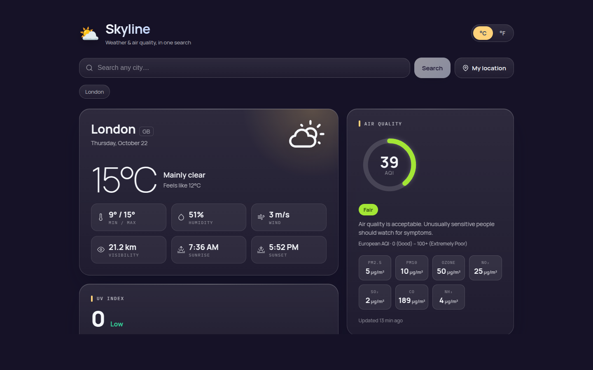

# Skyline 🌤️

> **Archived.** A finished example, kept read-only: a keyless weather and air-quality dashboard (React, Vite, Open-Meteo). The live site keeps running. For my current frontend work see [Atlas](https://github.com/WickTech/Atlas).


A single-search **weather & air-quality dashboard** built with React. Type a city
once and Skyline resolves it to coordinates, then pulls **current conditions**,
an **hourly** and **5-day forecast**, **UV index**, **air quality**, severe-weather
**alerts**, and an interactive **weather map** for that exact spot — all on a
glassmorphic UI whose background reacts to the live weather.



**Live:** https://skyline-ten-jet.vercel.app

> Skyline merges two earlier projects (WeatherNow + AirNow) into one product.
> One lookup now answers both *"what's it like outside?"* and *"is the air clean?"*.

## Features

- 🔑 **No API key required** — every core feature runs on free, keyless APIs; nothing secret ships in the bundle.
- 🔎 **Autocomplete search** — Open-Meteo geocoding disambiguates cities by state/country; pick a result to load it by coordinates.
- 📍 **Geolocation** — one tap to load conditions for where you are (reverse-geocoded via BigDataCloud).
- 🌡️ **°C / °F toggle** — client-side conversion, never triggers a refetch; remembered in `localStorage`.
- ⏱️ **Next-24-hours strip** — hourly temperature and precipitation chance (Open-Meteo).
- 📅 **5-day forecast** — daily min/max and conditions (Open-Meteo), labelled in the location's own calendar.
- ☀️ **UV index** — current value + daily peak, WHO risk bands (Open-Meteo).
- 🟢 **Air Quality** — European AQI (Open-Meteo / CAMS, global) on a hand-built SVG gauge, health guidance, and a PM2.5 / PM10 / O₃ / NO₂ / SO₂ / CO / NH₃ breakdown (µg/m³).
- ⚠️ **Severe-weather alerts** — *optional*: OpenWeather One Call 3.0, shown only if you configure a key.
- 🗺️ **Interactive map** — Leaflet + OpenStreetMap base with a keyless RainViewer radar frame; OpenWeather layers (precipitation, clouds, temperature, wind, pressure) appear if you configure a key.
- 🎨 **Weather-reactive theme** — the animated background gradient shifts with the conditions and time of day.
- ✨ **Polished states** — shimmer skeletons while loading, friendly empty/error states, fully responsive, reduced-motion support. Every secondary source degrades gracefully if it fails.

## Tech

- **React 18** + **Vite**, functional components + hooks; **Vitest** for the data-layer tests
- **react-leaflet** / **leaflet** for the map, **react-icons** for iconography
- Native **`fetch`** (no axios) with a small typed error layer
- **Open-Meteo** (current · hourly · UV · 5-day · air quality · geocoding),
  **BigDataCloud** (reverse geocoding), **RainViewer** (radar), **OpenStreetMap** (base tiles),
  optional **OpenWeather** (map layers · One Call alerts)

## Getting started

```bash
git clone https://github.com/WickTech/skyline.git
cd skyline
npm install

npm run dev        # http://localhost:3000
```

No configuration needed. Node ≥ 22.12.

### Optional: OpenWeather extras

| Variable | Purpose |
| --- | --- |
| `VITE_OPENWEATHER_KEY` | Enables extra map layers and One Call 3.0 severe-weather alerts |

> **Read this before setting it:** Vite inlines `VITE_*` variables into the client
> bundle **at build time**, so any key here is readable by every visitor. That's
> why the core app is keyless. If you enable it, use a key restricted to your domain
> in the OpenWeather dashboard, set it in your Vercel project settings, and redeploy.
> One Call 3.0 is a separate (free) subscription on the key; without it, alerts
> just don't appear.

## Project structure

```
src/
  api/          config · openMeteo.js · wmo.js · airQuality.js ·
                geocoding.js · alerts.js · maps.js  (+ adapters.test.js)
  hooks/        useEnvironment.js  — orchestrates the combined lookup
  utils/        format.js · aqi.js · theme.js
  components/   SearchBar · UnitToggle · CurrentWeather · Hourly · Forecast ·
                AirQuality · UvIndex · Alerts · WeatherMap · WeatherIcon ·
                Skeleton · StateMessage
  App.jsx       layout, state, theming
  index.jsx / index.css
```

## Scripts

| Command | Description |
| --- | --- |
| `npm run dev` | Run the dev server |
| `npm run build` | Production build into `build/` |
| `npm run preview` | Serve the production build locally |
| `npm test` | Run the Vitest suite |

## Credits

Weather & air quality by [Open-Meteo](https://open-meteo.com/) · reverse geocoding by
[BigDataCloud](https://www.bigdatacloud.com/) ·
radar by [RainViewer](https://www.rainviewer.com/) · base map ©
[OpenStreetMap](https://www.openstreetmap.org/) contributors. Built as a React UI showcase.

> Open-Meteo's free API is for **non-commercial use**; a commercial deployment needs
> an [Open-Meteo API plan](https://open-meteo.com/en/pricing).
